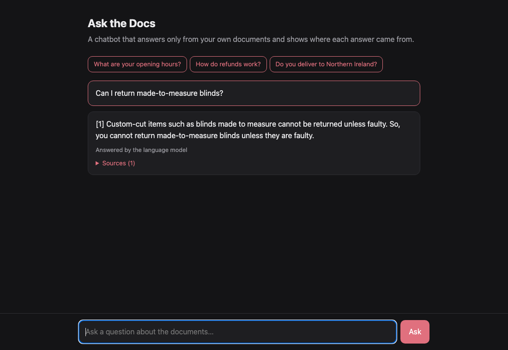

# RAG Chatbot Demo — "Ask the Docs"

A small, production-shaped chatbot that answers questions **only from your own documents** and cites the section each answer came from.

- **Private by default:** runs on a local model through Ollama, so documents never leave your machine. Any OpenAI-compatible API (OpenAI, Groq, Together…) works by changing three env vars.
- **Grounded answers:** retrieves the most relevant sections first; says "I don't know" instead of guessing.
- **Keeps working when the model is down:** falls back to showing the best-matching section.
- **Simple to extend:** drop `.md`/`.txt` files in `docs/` and call `POST /api/reload`.



Tip: link straight to a question with `/?q=your+question`.


## Run it

```bash
python3 -m venv .venv && .venv/bin/pip install -r requirements.txt
ollama pull qwen2.5:3b          # or set LLM_* for a hosted API, see .env.example
.venv/bin/uvicorn app.main:app --reload
```

Open http://localhost:8000.

Docker: `docker build -t rag-demo . && docker run -p 8000:8000 -e LLM_BASE_URL=http://host.docker.internal:11434/v1 rag-demo`

## API

| Method | Path | Description |
|---|---|---|
| POST | `/api/ask` | `{"question": "..."}` → answer, mode (`llm`/`extractive`/`no-match`) and sources |
| POST | `/api/reload` | Re-index `docs/` after adding files |
| GET | `/api/health` | Status and chunk count |

## How it works

1. Documents are split by heading into chunks.
2. A TF-IDF index finds the closest chunks to the question (swap in vector embeddings for larger collections).
3. The top chunks go to the model with instructions to answer only from them and cite `[n]`.

## Tests

```bash
.venv/bin/pip install -r requirements-dev.txt && .venv/bin/pytest
```

## Taking it further (what I build for clients)

PDF/Word/website ingestion, vector databases (pgvector, Qdrant), website chat widgets, Slack/Teams bots, lead capture and email summaries, admin dashboards and deployment.

---
Built by **Deepak Radhakrishnan** — senior Python & AI engineer, UK. [GitHub](https://github.com/dpkrobomad) · [LinkedIn](https://www.linkedin.com/in/deepak-radhakrishnan-73028a2a8/)

The sample company in `docs/` is fictional.
